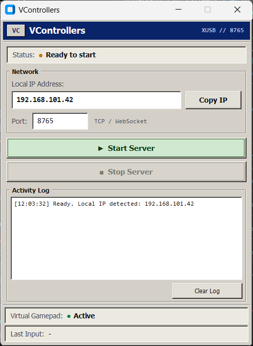

# VControllers (v1.1.0)



Windows & macOS 15+ desktop application (CustomTkinter) that receives gamepad, trackpad/mouse, keyboard, and custom button inputs from the Android app over WebSocket.

## Download Application (`.exe`)

No Python installation required — download the standalone Windows executable directly from the releases page:

- **[Download VControllers.exe (Latest Release)](https://github.com/msuryasyahruli/Virtual-Controller-Server/releases/latest/download/VControllers.exe)**
- **[View All Releases](https://github.com/msuryasyahruli/Virtual-Controller-Server/releases/latest)**
- **[Android Client App (Mobile-Virtual-Controller)](https://github.com/msuryasyahruli/Mobile-Virtual-Controller.git)**

> **Note:** The **ViGEmBus** driver must still be installed on Windows before running `VControllers.exe`.

## Requirements

- **Windows 10 / 11** with **ViGEmBus** driver (https://github.com/nefarius/ViGEmBus/releases)
- **OR macOS 15.0 (Sequoia) or newer** *(uses built-in macOS Keyboard Bridge via CoreGraphics)*
- Python 3.8 or newer _(only required when running from source)_
- Host computer and Android device connected to the same WiFi network

## Project Structure

- `server_app.py` — Main desktop GUI application (entry point)
- `gamepad_controller.py` — Platform controller backend (Windows ViGEmBus Xbox 360 / macOS 15+ Keyboard Bridge)
- `websocket_server.py` — Async WebSocket server (`asyncio`, single active client)
- `requirements.txt` — Python dependencies

## Installation & Running (from Source)

1. **Driver / Platform Setup**
   - **Windows:** Download and install the latest **ViGEmBus** `.exe` from https://github.com/nefarius/ViGEmBus/releases (restart if prompted).
   - **macOS 15+:** No extra driver needed. Ensure your Mac is running **macOS 15.0+**, and grant **Accessibility** permission to Terminal / Python / VControllers in **System Settings → Privacy & Security → Accessibility** so simulated keystrokes work.

2. **Install Python dependencies**  
   Open a terminal in the `python-server` folder and run:

   ```bash
   python3 -m pip install -r requirements.txt
   ```

3. **Launch the desktop app**

   ```bash
   python3 server_app.py
   ```

4. **Start the server & connect from Android**  
   Click **Start Server**, then enter the displayed local IP address into the **[VControllers Android app](https://github.com/msuryasyahruli/Mobile-Virtual-Controller.git)** (default port `8765`).

## macOS 15+ Keyboard Mapping

Because macOS 15 (Sequoia) restricts userspace virtual HID gamepads without Apple DriverKit entitlements, macOS maps controller inputs to keyboard keys via `CoreGraphics`:

| Gamepad Input | macOS Key | Gamepad Input | macOS Key |
| --- | --- | --- | --- |
| `A` / `B` / `X` / `Y` | `Space` / `Esc` / `R` / `F` | `Left Stick` | `W` `A` `S` `D` |
| `LB` / `RB` | `Q` / `E` | `D-Pad` | `Arrow Keys` |
| `LT` / `RT` | `Z` / `X` | `START` / `SELECT` | `Return` / `Tab` |
| `L3` / `R3` | `Left Shift` / `V` | | |

## Windows Firewall Note

Windows Firewall may block incoming connections from your Android device. Make sure TCP port **8765** is allowed:

- The first time you click **Start Server**, select **Allow access** on the Windows Defender Firewall prompt for **Private** networks.
- Or open PowerShell as **Administrator** and run:
  ```powershell
  New-NetFirewallRule -DisplayName "VControllers (TCP 8765)" -Direction Inbound -Protocol TCP -LocalPort 8765 -Action Allow
  ```

## Building `.exe`

1. Install PyInstaller:

   ```bash
   python -m pip install pyinstaller
   ```

2. Build `VControllers.exe` without a console window:
   ```bash
   python -m PyInstaller --onefile --windowed --name "VControllers" --collect-all customtkinter --collect-all vgamepad server_app.py
   ```

The compiled executable will be generated at `dist/VControllers.exe`.

## License

This project is licensed under the MIT License — see the [LICENSE](LICENSE) file for details.
